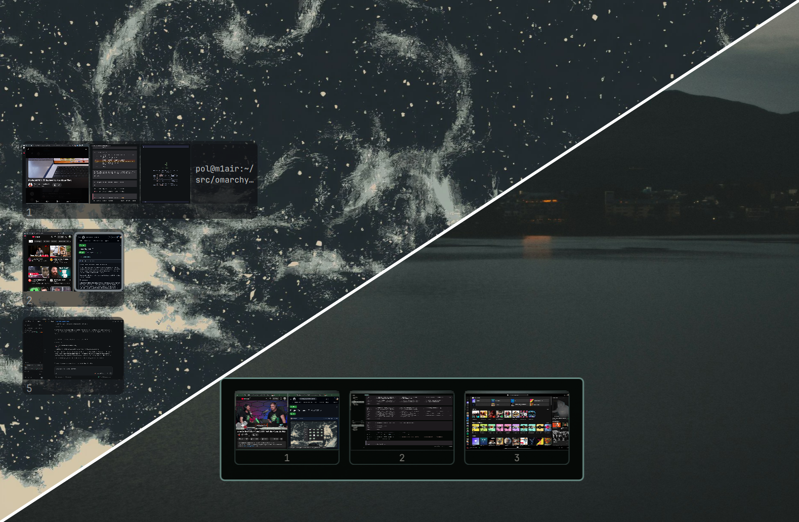

# Omarchy Workspace Peek

Preview your Hyprland workspaces while switching. Works with your mouse too.



## Controls

- Switching workspaces opens the overview automatically.
- Mouse: touch the bottom edge of the focused monitor to open it (or the configured side edge in vertical mode), then click a workspace card to switch there.
- The overview stays open while the pointer is over the cards and hides after it leaves.

## Features

- Recreates tiled and floating layouts from Hyprland geometry, including columns scrolled out of view.
- No chrome: transparent cards with no wallpaper or dimming — only the focused window gets an accent border, tracking live focus.
- Click any window tile to focus it directly; clicking empty card space switches to that workspace.
- Stays open while you keep working: any window or workspace action resets the auto-hide countdown; it only closes after a quiet spell.
- Horizontal row or vertical column: set `orientation` to `"vertical"` for a side-centered column (pick the side with `verticalSide`: `"right"` or `"left"`).
- Shows current wallpaper and theme styling, with the focused workspace highlighted.
- Follows the focused monitor and avoids a bottom-positioned bar (or a side-positioned bar in vertical mode).
- Captures one still thumbnail per window; no live capture or idle GPU work.

## Install

```sh
omarchy plugin add https://github.com/pablopunk/omarchy-workspace-overview.git --enable
```

Requires Omarchy Quattro with Hyprland and Quickshell. There are no external dependencies.

## Configure

Edit `~/.config/omarchy/plugins/pablopunk.workspace-overview/WorkspaceOverview.qml`.
Available settings include `duration` (1300 ms), `cardWidth`, `cardGap`, `panelMargin`, `sideMargin` (vertical edge distance), `edgeEnabled` (true), `edgeHeight`, `edgeWidth`, `orientation` (`"horizontal"` or `"vertical"`), and `verticalSide` (`"right"` or `"left"`).

Restart after code changes:

```sh
omarchy restart shell
```

## Commands

```sh
omarchy-shell workspace-overview open
omarchy-shell workspace-overview close
omarchy-shell workspace-overview toggle
omarchy-shell workspace-overview state
```

## Remove

```sh
omarchy plugin remove pablopunk.workspace-overview
```

## License

[MIT](LICENSE)
